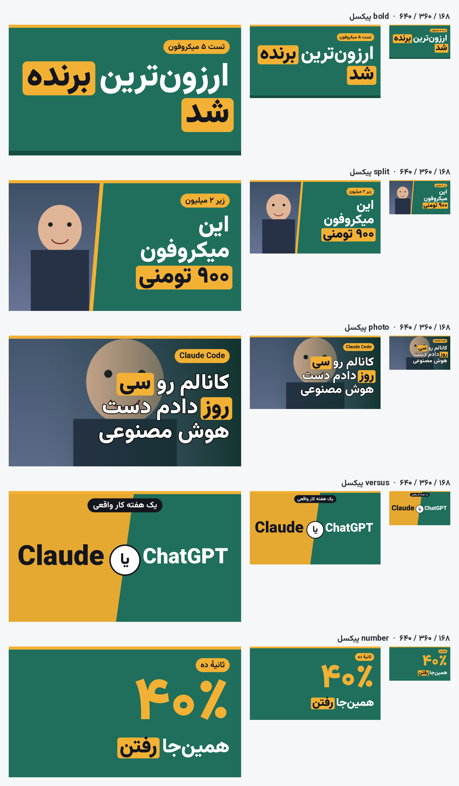

# youtube-fa — بستهٔ فارسی یوتیوب و آپارات برای Claude

> **English:** A Claude plugin (15 skills) for Persian-language YouTube and Aparat channels: channel profile and voice, scripts with scored Persian hooks, titles and Persian thumbnails, edit lists and chapters from Persian subtitles, Shorts, retention analysis, SEO, comment replies, a Jalali-calendar weekly plan, and manual or automatic publishing. Persian adaptation of youtube-agent-skill by Jake Schincariol. MIT licensed.

پانزده اسکیل که یک کانال فارسی را از ایده تا انتشار جلو می‌برند: شناسنامهٔ کانال و صدای گفتاری،
فیلم‌نامه با قلاب امتیازدار فارسی، عنوان و تامبنیل به‌عنوان یک جفت، ساخت تامبنیل فارسی، فهرست برش
تدوین از زیرنویس فارسی، چپتر، شورتس، تحلیل ماندگاری مخاطب، توضیحات و تگ، جواب کامنت، برنامهٔ هفتگی با
اکسل شمسی، بررسی کانال، و انتشار در **یوتیوب و آپارات** — دستی یا خودکار.

**به هیچ موضوعی گره نخورده.** موضوع، مخاطب، لحن و رنگ‌های هر کانال در «شناسنامهٔ کانال» آن ذخیره
می‌شود؛ برای کانال دوم فقط `yt-setup` را دوباره اجرا کن.

**انتشار به انتخاب خودت.** هر کانال دو تنظیم دارد: «حالت تأیید» (دستی: هر ویدیو با «بله»ی تو؛ خودکار:
بعد از چک‌های فنی، بدون پرسیدن) و «روش انتشار» جدا برای یوتیوب و آپارات (خودت آپلود می‌کنی؛ یا
آپلود خودکار). پیش‌فرض همه دستی است.

بر پایهٔ [youtube-agent-skill](https://github.com/Jakeschincariol/youtube-agent-skill) از Jake
Schincariol (MIT)، بازنویسی‌شده برای زبان و شرایط فارسی (همان روش instagram-fa)، و گسترش‌یافته با
تامبنیل، آپارات و انتشار.

---

## پانزده اسکیل

| اسکیل | کار |
|---|---|
| `yt-setup` | شناسنامهٔ کانال و **صدای گفتاری** (`voice.md`)؛ مخاطب داخل یا خارج ایران؛ چند کانال |
| `yt-script` | فیلم‌نامه: ۵ قلاب از **۲۱ فرمول فارسی**، امتیازدار، و متن گفتاری با «روی صفحه» برای هر بخش |
| `yt-package` | عنوان و متن تامبنیل به‌عنوان یک جفت؛ طول دیداری، برش موبایل، تکرار کلمه، کلیک‌بیت فارسی |
| `yt-thumb` | **ساخت تامبنیل فارسی** ۱۲۸۰×۷۲۰ در ۵ چیدمان، با برگهٔ مقایسه در اندازهٔ واقعی فید |
| `yt-edit` | فهرست برش از زیرنویس: مکث، تکیه‌کلام فارسی («اِم»، «یعنی»، «چیزه»)، برداشت تکراری |
| `yt-chapters` | چپتر از زیرنویس، با بررسی قواعد خود یوتیوب |
| `yt-shorts` | پیدا کردن شورتس‌های مستقل در ویدیوی بلند و نوشتن جملهٔ اول تازه |
| `yt-retention` | خواندن نمودار ماندگاری مخاطب: نشت قلاب، پرتگاه‌ها (با حرفی که آنجا زدی)، سُرخوردن |
| `yt-seo` | توضیحات، تگ و هشتگ رو به کوئری واقعی (فارسی، فینگلیش)؛ عنوان و برچسب آپارات |
| `yt-comment` | جواب کامنت با عرف فارسی؛ دسته‌بندی، پین، ایده از سؤال‌ها (فقط نوشتن، نه ارسال) |
| `yt-plan` | برنامهٔ هفته به اندازهٔ وقت واقعی؛ **اکسل رنگی با تاریخ شمسی** و حساب ساعت کار |
| `yt-viral` | آنچه در حوزه‌ات جواب می‌دهد، با «چند برابرِ میانهٔ همان کانال»؛ بومی‌سازی مدل کانال‌های خارجی |
| `yt-audit` | بررسی کانال که به **یک** اصلاح ختم می‌شود؛ درس‌ها در `insights.md` |
| `yt-human` | انسانی‌ساز فارسی با کلیشه‌های گفتاری یوتیوب؛ **نیم‌فاصله را حفظ می‌کند** |
| `yt-publish` | تأیید دستی یا خودکار، چک فنی، **آپلود خودکار یوتیوب** (با زمان‌بندی خود یوتیوب) و **آپارات** (تجربی)، یا پوشهٔ آماده؛ دفتر انتشار |



## ابزارهایی که واقعاً اجرا می‌شوند

| ابزار | کار |
|---|---|
| `yt-setup/channel.py` | مدیریت کانال‌ها و پوشه‌ها |
| `yt-script/hookscore.py` + `hooks.json` | امتیاز قلاب ۱۵ ثانیهٔ اول؛ ۲۱ فرمول فارسی |
| `yt-package/title.py` | بررسی جفت عنوان و تامبنیل |
| `yt-thumb/thumb.py` | تامبنیل فارسی با Pillow + raqm، فونت وزیرمتن و لاله‌زار |
| `yt-edit/deadair.py` | فهرست برش از SRT، VTT یا JSON خروجی Whisper؛ خروجی CSV |
| `yt-chapters/chapters.py` | چپتر و بررسی فهرست چپتر |
| `yt-shorts/shorts.py` | پنجره‌های ۲۰ تا ۵۸ ثانیه‌ای مستقل |
| `yt-retention/retention.py` | تحلیل خروجی ماندگاری مخاطب، با ستون‌ها و رقم فارسی |
| `yt-seo/seo.py` | بررسی دو خط اول، کوئری‌ها، سقف تگ، هشتگ، چپتر |
| `yt-viral/swipe.py` | رتبه با ضریب میانه؛ ورودی JSON، TSV یا خروجی yt-dlp |
| `yt-plan/plan_xlsx.py` | اکسل برنامه با تاریخ شمسی و برگهٔ «وقت» |
| `yt-human/humanize.py`، `detect.py` | انسانی‌ساز و پنل |
| `yt-publish/publish.py` | حالت تأیید، چک فنی، انتشار، صف (`due`)، زمان‌بند ویندوز و cron (`schedule`) |
| `yt-publish/yt_api.py` | YouTube Data API v3: ورود OAuth (loopback + PKCE)، آپلود تکه‌ای، تامبنیل |
| `yt-publish/aparat_api.py` | آپارات: ورود، فرم آپلود، آپلود جریانی (تجربی) |

همهٔ ابزارهای متنی فقط کتابخانهٔ استاندارد پایتون لازم دارند. تامبنیل: `pillow`. اکسل: `openpyxl`.

---

## کجا اجرا می‌شود (مهم)

| کار | محیط Claude (ابری) | کامپیوتر خودت |
|---|---|---|
| شناسنامه، فیلم‌نامه، عنوان، توضیحات، چپتر، تحلیل‌ها، اکسل، تامبنیل | ✓ | ✓ |
| آپلود خودکار یوتیوب و آپارات، ورود به حساب‌ها، زمان‌بند | ✗ | ✓ |
| جمع کردن فهرست ویدیوهای کانال‌های دیگر با yt-dlp | ✗ | ✓ |

محیط ابری Claude به یوتیوب و آپارات دسترسی ندارد. این بخش‌ها روی کامپیوتر خودت اجرا می‌شوند: یا Claude
دسکتاپ آن‌ها را روی کامپیوترت اجرا می‌کند (وقتی گفتگو به کامپیوترت وصل است)، یا Claude دستور دقیق را
می‌دهد و خودت در cmd می‌زنی. برای یوتیوب از ایران فیلترشکن لازم است.

---

## نصب

### در Claude دسکتاپ

فایل `youtube-fa.plugin` را در گفتگو باز کن و «نصب» را بزن (همان روش instagram-fa). بعد پوشهٔ
Documents را به گفتگو وصل کن و بگو: «yt-setup رو اجرا کن».

### پیش‌نیازها برای اجرا روی سیستم خودت

- **Python 3.9+**، `pip install pillow openpyxl`
- برای ویدیوی آزمایشی و بررسی مدت ویدیو: **ffmpeg** (ویندوز: `winget install ffmpeg`)
- اختیاری: `yt-dlp` برای `yt-viral`؛ Subtitle Edit یا whisper برای زیرنویس

### در Claude Code، به‌عنوان پلاگین

```
/plugin marketplace add hafamfamily/youtube-fa
/plugin install youtube-fa@youtube-fa
```

(اگر مخزن خصوصی است، Claude Code باید به حساب گیت‌هاب تو دسترسی داشته باشد.)

### یا کپی دستی

پوشه‌های `skills/yt-*` را در پوشهٔ اسکیل‌های Claude Code کپی کن (ویندوز: `%USERPROFILE%\.claude\skills\`؛
مک و لینوکس: `~/.claude/skills/`). **همهٔ ۱۵ پوشه را کنار هم بگذار**؛ بعضی اسکیل‌ها از ابزار
اسکیل‌های دیگر استفاده می‌کنند.

---

## روند کار

**بار اول**
1. `yt-setup`: مصاحبهٔ کوتاه، شناسنامهٔ کانال، صدای گفتاری، هویت تامبنیل، حالت انتشار.
2. اگر آپلود خودکار می‌خواهی: `skills/yt-publish/API-SETUP.md` (یوتیوب حدود ۲۰ دقیقه، آپارات ۵ دقیقه).

**هر هفته**
1. «برنامهٔ هفته رو بچین» ← `yt-plan` (+ اکسل)
2. برای ویدیوی اصلی: `yt-script` ← ضبط ← زیرنویس ← `yt-edit` ← تدوین ← `yt-chapters`
3. بسته‌بندی: `yt-package` ← `yt-thumb` ← `yt-seo`
4. شورتس: `yt-shorts`
5. تأیید و انتشار: `yt-publish`

**بعد از انتشار**
- ساعت اول: `yt-comment`
- بعد از چند روز: `yt-retention` با خروجی استودیو

**هر ماه**
- `yt-audit`، و `yt-viral` برای تازه کردن فایل الهام.

---

## پوشه‌های هر کانال

پیش‌فرض `Documents/youtube-fa/<نام-کانال>/` در Claude دسکتاپ، وگرنه `~/youtube-fa/` (با
`channel.py home` قابل تغییر):

```
channel.md      شناسنامهٔ کانال — همهٔ اسکیل‌ها اول این را می‌خوانند
voice.md        صدای گفتاری: کلمه‌های ممنوع، تکیه‌کلام‌ها، ادعاهایی که نمی‌کنیم
brand.json      رنگ‌ها، فونت، رقم فارسی، امضای تامبنیل
plan/           برنامه‌ها (json، xlsx)
videos/         هر ویدیو یک پوشه: status.json، meta.json، script.md، video.mp4، thumb/، transcript.srt
data/           خروجی‌های استودیو (ماندگاری، آمار)
ready/          تأییدشده‌ها با «انتشار.md» برای آپلود دستی
publish.json    حالت تأیید و روش انتشار هر سکو (محرمانه نیست)
publish.log     گزارش انتشارهای خودکار
published.csv   دفتر انتشار (یوتیوب و آپارات)
swipe.md        فایل الهام (yt-viral)
insights.md     درس‌ها (yt-audit، yt-retention)
```

توکن‌ها جدا، در `<خانهٔ کانال‌ها>/.secrets/<نام کانال>.json`، فقط برای کاربر همان سیستم خواندنی.
هرگز در گیت یا جای عمومی نگذارش (`.gitignore` آن را و فایل کلید گوگل را کنار می‌گذارد).

---

## محدودیت‌ها (صادقانه)

- **این کدها روی یوتیوب و آپارات واقعی آزمایش نشده‌اند**؛ با سرور شبیه‌سازی تست شده‌اند که رفتار
  مستند API را تقلید می‌کند (`tests/mock_api.py`). اولین انتشار واقعی را با `--dry-run` و بعد با یک
  ویدیوی کم‌اهمیت «خصوصی» امتحان کن.
- **آپلود خودکار یوتیوب** یک بار راه‌اندازی در Google Cloud لازم دارد. اگر صفحهٔ رضایت OAuth روی
  «Testing» بماند، گوگل هر ۷ روز توکن را باطل می‌کند؛ راهنما می‌گوید چطور نشود. تامبنیل سفارشی و ویدیوی
  بالای ۱۵ دقیقه به تأیید شماره تلفن کانال نیاز دارند. سهمیهٔ روزانهٔ API محدود است.
- **آپلود خودکار آپارات تجربی است:** آپارات API رسمی و مستندِ به‌روزی برای آپلود ندارد؛ این ابزار از API
  عمومی قدیمی آن استفاده می‌کند که ممکن است هر زمان عوض شود. اگر کار نکرد، روش آپارات را دستی بگذار.
- **امتیاز قلاب، عنوان و پنل انسانی‌ساز نشانه‌اند، نه پیش‌بینی بازدید.** قلاب و عنوان بد را خوب جدا
  می‌کنند؛ بین دو گزینهٔ خوب، آمار واقعی کانال داور است. قواعد فارسی با جمله‌های نمونه تنظیم شده، نه با
  آمار بزرگ کانال‌های فارسی.
- **عددهای یوتیوب عوض می‌شوند** (برش ۶۰ و ۴۰ حرفی، سقف ۵۰۰ حرفی تگ، ۳ دقیقهٔ شورتس). هر کدام در اسکریپت
  یک ثابت است و راحت عوض می‌شود.
- **فونت‌ریزی فارسی در تامبنیل** به Pillow با libraqm نیاز دارد؛ اگر نبود، `arabic-reshaper` و
  `python-bidi` جایگزین ساده‌تری‌اند.

---

## تست پیش از هر نسخه

```bash
python tests/run.py                 # ۱۶ تست: همهٔ ابزارها، اکسل، تامبنیل، و انتشار با سرور شبیه‌ساز
python tools/sync_fa_text.py        # بعد از هر تغییر در tools/fa_text.py
```

`fa_text.py` عمداً کنار هر اسکیلی که اسکریپت دارد تکرار شده تا هر اسکیل مستقل کار کند؛ نسخهٔ اصلی در `tools/` است.

## تغییرات

**۱.۰.۰**
- بازنویسی فارسی ۱۱ اسکیل youtube-agent-skill: فرمول‌ها و ابزارهای امتیازدهی فارسی، تکیه‌کلام‌های فارسی در
  تدوین، ستون‌ها و رقم فارسی در تحلیل ماندگاری، کوئری‌های فارسی و فینگلیش.
- اسکیل‌های تازه: `yt-setup` (شناسنامه و صدای گفتاری)، `yt-thumb` (تامبنیل فارسی)، `yt-human` (انسانی‌ساز)،
  `yt-publish` (تأیید و انتشار یوتیوب و آپارات).
- ابزارهای تازه: `shorts.py`، `seo.py`، `plan_xlsx.py`، `thumb.py`، `publish.py`، `yt_api.py`، `aparat_api.py`.
- نقشهٔ بومی‌سازی: `docs/LOCALIZATION.md`.

---

## مجوز و قدردانی

MIT. نسخهٔ اصلی انگلیسی: youtube-agent-skill از Jake Schincariol (MIT). موتور متن فارسی، انسانی‌ساز و
الگوی انتشار از instagram-fa. فونت‌های وزیرمتن و لاله‌زار با مجوز SIL Open Font License 1.1
(`skills/yt-thumb/fonts/`).
